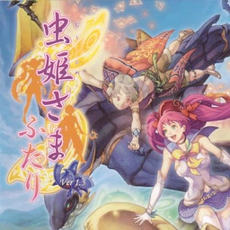

<div align=center>



</div>
<h1 align=center>Mushihimesama Futari — Nintendo Switch port</h1>

A native Nintendo Switch port of the Xbox 360 version of **Mushihimesama Futari Ver 1.5** (CAVE, 2009), with the
**Black Label** and **Ver 1.01** downloadable content.

It's not an emulator. The PowerPC code of the game's `default.xex` and of its eight game cores (`media/Module/*.xex`)
is statically recompiled to C++ with [ReXGlue](https://github.com/rexglue/rexglue-sdk) and compiled for the Switch, and
the game is drawn by a native Vulkan renderer running on NVK (Mesa).

> [!NOTE]
> You need your own copy of the Xbox 360 disc (a disc image, `.iso`). The Black Label and Ver 1.01 DLC packages
> (`Content/<profile>/435A07D7/00000002`) are optional.

## How to install

1. Open the installer page: **https://chanseyisthebest.github.io/futari-nx-installer/**
2. Choose your game: its **disc image** (`.iso`; you can choose the DLC package files along with it) or a **folder**
   you extracted the game into. Then press **Create futari-nx.zip**. Everything runs in your browser and the game
   files never leave your computer: the page checks your copy, downloads the build and makes the shaders from your
   game's own executables.
3. Extract the downloaded `futari-nx.zip` into `sdmc:/switch/`.

Your `futari-nx` folder should look like this:

```text
/switch/futari-nx/
  futari.nro
  LICENSES.txt
  futari.toml               (your settings; written at the first start when it is missing)
  futari_shaders.mesp       (the game's shaders, made from your copy)
  futari_shaders.mesp.idx
  game_root/                (the files of your disc)
  dlc/                      (optional: Black Label and Ver 1.01, installed by the game at its first start)
```

Launch it with a game override (hold **R** while starting an installed title) or a forwarder. Album applet mode does
not give the game enough memory. If you use a forwarder, set it to a **39-bit address space**.

To build everything yourself instead, see [docs/building.md](docs/building.md).

> [!NOTE]
> **Updating:** open the installer page again and press **Create futari-nx-update.zip**. It only holds the new
> `futari.nro` and the shaders, so there is no need to copy the game again: extract it over your folder. Your
> `futari.toml`, your saves, the game files and the `cache` folder stay.

> [!CAUTION]
> **The first time you play** after installing or updating, the game compiles the graphics pipelines it has not seen
> yet, so **IT CAN STUTTER for a moment** in new places. They are saved in `cache/` on the SD card and later sessions
> start smoothly.

## Controls

By default the face buttons work **by position, as on the Xbox 360 pad** the game was made for: the bottom button is
the Xbox's A, the right one is the Xbox's B, and so on.

<div align="center">

| Switch | Xbox 360 |
| --- | --- |
| B (bottom) | A |
| A (right) | B |
| Y (left) | X |
| X (top) | Y |
| ZR / ZL | RT / LT |
| R / L | RB / LB |
| + | Start |
| − | Back |
| Sticks / D-pad | Sticks / D-pad |

</div>

To use the buttons by letter instead (the Switch's A acts as A), set `input_xbox_layout = false` in `futari.toml`.

**Two players:** every controller is its own player, in the order they connect. The console in handheld mode counts
as one, so handheld + a Pro Controller makes players 1 and 2. Single Joy-Cons are held sideways, one per player (SL
and SR are the triggers). **L + R + ZR** opens the system's controller screen to connect, reorder, or split a Joy-Con
pair.

**Remapping:** each player has a button map in `futari.toml` (`[input_p1]` and `[input_p2]`).

## Settings

`futari.toml`, next to the NRO, holds only your options. Everything else is built into the NRO.

<div align="center">

| Setting | What it does |
| --- | --- |
| `input_xbox_layout` | Face buttons by position (`true`, default) or by letter (`false`) |
| `input_joycon_sideways` | Single Joy-Cons held sideways, one per player (`true`, default) |
| `[input_p1]`, `[input_p2]` | Each player's buttons: for every Xbox button, the Switch buttons that press it, e.g. `a = "B, ZR"` |

</div>

If you delete `futari.toml`, the game writes the default one again at the next start.

## Performance

The port runs at the console's stock clocks. The released NRO is built with link-time optimisation, PGO from a
console session and the hottest functions first in memory. Every optimisation has its own setting and was checked on
the PC to give exactly the same picture, frame for frame: the measurements are in
[docs/futari-notes.md](docs/futari-notes.md).

## How it works

- **The game's code is translated, not emulated.** [ReXGlue](https://github.com/rexglue/rexglue-sdk) translates every
  function of the game's program and of its eight game cores (one per character and mode, all built for the same
  address and linked statically on the Switch) to C++, which is then compiled for the Switch. ReXGlue also gives the
  game what it expects from an Xbox 360: its system, files, audio and controllers.
- **Its own renderer.** The game's GPU command stream is drawn with Vulkan by a native renderer, and the busiest
  Direct3D paths are replaced by native code that hands the renderer its records directly.
- **Shaders translated beforehand.** Futari keeps all its shaders inside its executables: the installer takes them
  from your copy, translates them with [XenosRecomp](https://github.com/hedge-dev/XenosRecomp) and DXC, and packs them.
- **Graphics driver.** Vulkan runs on NVK, from the Mesa project, through
  [mesa-switch](https://github.com/danfromtico/mesa-switch), in the build of
  [nfsmw-nx](https://github.com/StevensND/nfsmw-nx).
- **Audio.** The game's own mixer output goes to the Switch's audio service. The game cuts and restarts sounds on
  its 256-sample audio frame edges (a sound retriggered every few frames cuts its previous instance); the Switch output
  smooths those steps so they do not click.

## Documentation

<div align="center">

| Document | What it explains |
| --- | --- |
| [docs/building.md](docs/building.md) | How to build the PC test build, the NRO, the shader package and the SD folder |
| [docs/futari-notes.md](docs/futari-notes.md) | The port step by step: findings in the game's code, every optimisation and how it was checked |
| [docs/research/](docs/research/) | Research notes and comparisons with the sibling ports |

</div>

## Build

Windows, LLVM clang 20 and the VS 2022 Build Tools for the PC build; devkitA64 and libnx from
[devkitPro](https://devkitpro.org) and NVK built from [mesa-switch](https://github.com/danfromtico/mesa-switch) for the
Switch; Python; and your own copy of the game for the code generator. The whole process is in
[docs/building.md](docs/building.md).

<div align="center">

| Folder | Contents |
| --- | --- |
| `app/` | The game: hooks, native renderer, native functions, settings, CMake project |
| `sdk/` | ReXGlue SDK with the Horizon layer and the code generator changes |
| `shaders/` | XenosRecomp with the ports' changes, the shader package tools and the installer's WebAssembly builds |
| `tools/` | Code generation steps, build and test scripts, analysis tools |
| `patches/` | Every change to third-party code (the SDK, FFmpeg, XenosRecomp) as diffs against upstream |
| `pgo/` | The PGO profile the released NRO was built with |
| `mesa/` | Which NVK driver build the NRO links |
| `docs/` | Documentation |

</div>

## Credits

- **CAVE** — creators of Mushihimesama Futari. This is an unofficial, fan-made port with no affiliation.
- **ChanseyIsTheBest** — this port.
- **[Tom Clay](https://github.com/rexglue/rexglue-sdk)** — the ReXGlue SDK, built on the work of the
  **[Xenia](https://xenia.jp)** team.
- **[StevensND](https://github.com/StevensND/nfsmw-nx)** — nfsmw-nx: the Switch layer of the SDK, the NVK build and
  much of the method; and [nfsmw-nx-installer](https://github.com/StevensND/nfsmw-nx-installer), the installer page
  this port's is built on.
- **[nebadasSwifty](https://github.com/nebadasSwifty/masseffect-nx)** — masseffect-nx: the native renderer this port's
  renderer grew from.
- **[hedge-dev](https://github.com/hedge-dev/XenosRecomp)** — XenosRecomp, the Xenos shader translator.
- **[danfromtico](https://github.com/danfromtico/mesa-switch)** and **[NaGaa95](https://github.com/NaGaa95/mesa-switch)**
  — mesa-switch: Mesa, NVK and NAK on Horizon.
- **[devkitPro](https://devkitpro.org) and [switchbrew](https://github.com/switchbrew/libnx)** — devkitA64 and libnx.
- The sibling ports ([Sonic Adventure 2](https://github.com/ChanseyIsTheBest/sa2-nx), Banjo-Kazooie: Nuts & Bolts,
  Sonic & All-Stars Racing Transformed, Peggle 2), which share their fixes with this one.
- The other libraries listed in [THIRD_PARTY_NOTICES.md](THIRD_PARTY_NOTICES.md).

## Legal

No affiliation with CAVE, Microsoft or Nintendo. "Mushihimesama Futari" is a trademark of CAVE Interactive. This
repository contains no assets or program code from the original game. Users must provide their own legally obtained
copy, and everything made from it (`assets/`, `app/generated/`, the shader package) is made on their own computer.
Running homebrew requires custom firmware, which violates Nintendo's ToS and can get a console banned — your call.

Source code is provided under the GPL-3.0 License (see [LICENSE](LICENSE)), like the ports it builds on. The SDK keeps
its BSD-3-Clause license (see [THIRD_PARTY_NOTICES.md](THIRD_PARTY_NOTICES.md)).
